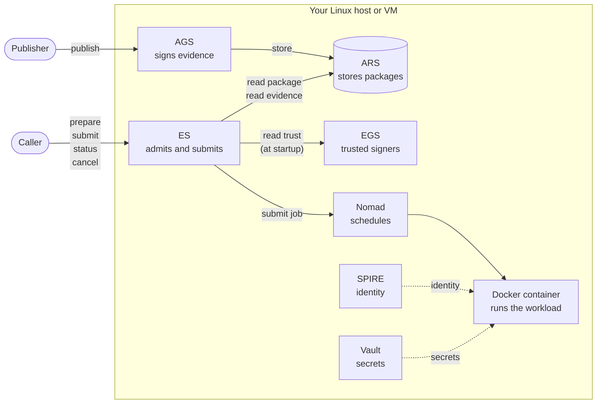

# Execution Substrate

Execution Substrate (ES) decides whether an exact, published piece of software
may run on a Linux machine you operate. If it may, ES runs it there through
Nomad and Docker and reports back what is actually known about the run.

The project's longer-term aim is to let any vendor's AI agent run on hardware
its owner controls, admitted under the owner's rules before it starts. That is
a goal, not a current capability. See [Current status](#current-status) for
what works today.

## How it works

ARS is the Artifact Registry Service, AGS the Artifact Governance Service, EGS
the Execution Governance Service, and ES the Execution Substrate service
itself. [Components](#components) below says what each part does.

1. **Publish.** A publisher sends a workload package to AGS: an archive with
   the code to run, plus what it declares it needs (environment variables,
   network access, and so on). AGS records signed evidence of exactly what was
   published and stores both in ARS.
2. **Admit.** A caller asks ES to run that exact package. ES reads the package
   and its evidence from ARS and checks them against the signed runtime trust
   that EGS publishes. ES loads that trust once, when it starts. Missing or
   corrupt evidence means the request is refused. `prepare` runs these checks without starting anything; `submit`
   runs them and then hands the run off.
3. **Run.** ES submits a job to Nomad, which starts the workload in a Docker
   container. A workload that needs secrets gets an identity from SPIRE and
   logs in to Vault itself, so ES does not handle the workload's tokens or
   secrets.
4. **Observe.** The caller reads status, logs and the retained result through
   ES, and can ask ES to cancel. Status is derived from what Nomad reports. A
   cancel is a request to stop, not proof that the workload has stopped.

Each of the five services in this repository (ARS, AGS, EGS, CGS and ES)
requires mutual TLS on every connection. Routes that check who is calling read
a SPIFFE ID from the caller's certificate, and each service allows only the
identities named for it.

## Current status

ES is a working, bounded platform. It is not a finished product.

- **Works today:** the publish, admit, run and observe path above, on one
  Linux host or VM with Nomad and Docker on the same machine. GitHub Actions
  builds, vets and tests the Go module on Linux on every pull request, and
  runs the tests of the operator scripts package on macOS as well.
- **Not yet done:** no real AI coding agent has been run through ES end to
  end. The agent path in this repository uses a deterministic, proof-only
  stand-in for the Codex CLI (see the
  [supported-local runbook](.docs/supported_local_cp_consumer_runbook.md)),
  and live agent proof is an open gap (G-06 in the
  [claim ledger](.docs/commercialization/claim-ledger.md)).
- **Not claimed:** production readiness, high availability, multi-tenant use,
  a general remote deployment architecture, or a complete installer for a
  fresh host (see the [MVP claim](.docs/mvp.md)).
- **In progress:** current work and open design questions are tracked in
  [PLANS.md](PLANS.md).

## Components

| Part | What it does |
| --- | --- |
| ARS (Artifact Registry Service) | Artifact storage. Keeps published packages and their evidence, checks their integrity, and lets ES find them. |
| AGS (Artifact Governance Service) | Publication. Accepts a package, records signed evidence of exactly what it is, and writes both to ARS. |
| EGS (Execution Governance Service) | Runtime trust. Publishes the signed statement of which signers and artifacts ES may trust. |
| CGS (credential governance) | A separate, authorize-only policy service. It is not on the path ES uses to run work today. |
| ES (Execution Substrate) | Admission and execution. Checks a request, submits the run to Nomad, and reports status, logs, results and cancellation. |
| Nomad | Schedules runs. Once a run is submitted, Nomad is the source of truth for its lifecycle. |
| Docker | Runs the workload's container under Nomad. |
| SPIRE | Issues workload identities (SPIFFE IDs). |
| Vault | Holds secrets. A workload gets them by logging in with its own identity. |

ARS, AGS, EGS, CGS and ES are the Go services in this repository. Nomad,
Docker, SPIRE and Vault are third-party software that ES uses. In the terms of
the design docs, this repository contains the current Go implementation of the
platform's governed publication, storage, policy, admission, and bounded
execution system.

Words used here:

- **Workload:** the program a caller wants to run, packaged and published
  through AGS.
- **Admission:** ES's decision, before anything starts, that this exact
  package may run with this request.
- **Evidence:** the signed record AGS writes about a package, which ES checks
  before admission.
- **Retained result:** files the workload writes under
  `/execution/run/result`, which ES may keep as one opaque bundle for the
  caller to download.

## Operator Quick Start

You need one Linux host or VM with Docker and Nomad, plus `curl`, `python3`,
`tar` and `gzip`, and the TLS material and service config described in the
bring-up runbook. On a Mac, the supported local setup runs inside an Ubuntu VM;
the runbook covers it.

For the current bounded execution slice, the preferred operator path is:

1. Follow [.runbooks/system/Governed Execution ES System Bring-Up.md](.runbooks/system/Governed%20Execution%20ES%20System%20Bring-Up.md)
2. Use `scripts/01_bringup.sh up` for the cohesive local bring-up path
3. Use `scripts/01_bringup.sh check` to re-check service health, prepare-ready state, and submit-ready state
4. Use `scripts/60_execute_loop.sh .examples/execution_loop/static_script_success.input.json` for the bounded end-to-end smoke path
5. Use `scripts/01_bringup.sh down` to stop the managed stack

### Operator notes

The lower-level readiness helper remains `scripts/10_health_check.sh`. In the current slice, ES `/health` proves only admission-oriented service health; the operator path now layers workload-zone Vault runtime-config validation plus Nomad/Docker checks on top before claiming submit readiness.
For those operator-facing helpers, the current caller credentials are `OPERATOR_CERT` and `OPERATOR_KEY`; `service/deployment` is no longer a co-equal hot-path caller identity for AGS or ES in this bounded slice.
The operator-facing publish / prepare / submit / lifecycle helpers now classify failures into bounded categories and point back to the compact troubleshooting matrix in [.runbooks/system/Governed Execution ES System Bring-Up.md](.runbooks/system/Governed%20Execution%20ES%20System%20Bring-Up.md). That matrix is the current operator reference for:

- which readiness check is authoritative
- which service logs matter most
- when retained staging is useful
- what next action to take

The bounded diagnostics collector is `scripts/70_diagnostics.sh`. Use `--category auth|trust|runtime-config|readiness|substrate|execution|input` or `--run-id run-...` to gather the exact logs/check outputs already named by that troubleshooting matrix. Then use `scripts/71_diagnostics_summary.sh <bundle_dir|bundle.json>` to print a compact summary of the collected bundle.

When a later helper reports a readiness or substrate problem, re-run `scripts/01_bringup.sh check` first instead of inferring readiness from a single endpoint call, then use that troubleshooting matrix or `scripts/70_diagnostics.sh`.

In the current bounded execution slice, every exclusively created
`execution.staging_root_dir/<run_id>` remains retained after claim, including
failed, ambiguous, accepted, successful, canceled, lost, and result-publication
outcomes. Workloads may write terminal result files under
`/execution/run/result`; ES may retain those as an independent opaque bundle
under `execution.results_root_dir`, but result publication never authorizes
staging deletion. Automatic whole-run-root reclamation is not implemented.

Remote Alpha existing-host ES writable-state readiness, readiness staging,
service-user migration, ownership preparation, rollback generation, and
old-root planning routes are retired fixed tombstones. Archived v1 artifacts
are historical evidence only, no live operator route parses or projects their
retired schemas, and no v2 replacement exists for that retired ES writable-
state/service-user migration family. The unrelated current EGS hardening v2
schema remains current. Future infrastructure recovery requires a separately
selected fresh-host setup contract, but this
repository does not currently provide a complete supported fresh-host ES
provisioner; old or nonempty host reuse remains blocked without a separately
governed migration contract.

For the bounded supported-local Control Plane consumer path, including the `control-plane-normal-shell/v1` runtime profile, submit-ready meaning, workload-visible identity/Vault/trust-material handoff, retained-result behavior, and ownership boundaries, use the canonical ES-side runbook: [.docs/supported_local_cp_consumer_runbook.md](.docs/supported_local_cp_consumer_runbook.md).

The Control Plane-owned long-running operator mode, releaseability, and scaling freeze lives in the adjacent Control Plane repo at `.docs/long-running-operator-mode-contract.md` (a separate repository, so it is not linked from here). ES must not widen this supported-local surface into CP orchestration, review, checkpoint, hold/resume/reject, or release authority without an explicit new contract.

## Repo Structure

High-level layout:

- `ars/`, `ags/`, `egs/`, `cgs/`, `es/` for the active Go services
- `internal/contracts/` for shared cross-service packages
- `internal/observability/` for cross-cutting support code
- `.docs/` for authoritative design, contract, boundary, lifecycle, and governance docs
- `.runbooks/` for operator-facing bring-up and verification steps
- `scripts/` and `.examples/` for local verification helpers and inputs

## Where To Start

This section is an index for contributors and coding agents. Use the README as a navigation entrypoint only. For architecture, contracts, boundaries, lifecycle semantics, and redesign intent, defer to the authoritative docs below. Where this README and those docs disagree, the docs win.

The repository is operating as a bounded platform with explicit reopened
seams. The current system is coherent and implemented. Some
architecture-defining seams remain intentionally reopened in `PLANS.md`, but
rewrite-by-default is no longer the operating stance. Authoritative design
intent lives in `PLANS.md` and `.docs/`, not in the README.

Read these in order:

1. [AGENTS.md](AGENTS.md) for repository operating rules
2. [PLANS.md](PLANS.md) for current work, redesign scope, and reopened seams
3. [.docs/system_overview/architecture.md](.docs/system_overview/architecture.md) for the top-level system map
4. [.docs/system_overview/contracts.md](.docs/system_overview/contracts.md) for cross-service contracts
5. [.docs/system_overview/boundaries.md](.docs/system_overview/boundaries.md) for ownership and non-ownership
6. [.docs/system_overview/evolution.md](.docs/system_overview/evolution.md) for change-governance rules
7. [.docs/execution_lifecycle/design.md](.docs/execution_lifecycle/design.md) for lifecycle design
8. [.docs/execution_lifecycle/contracts.md](.docs/execution_lifecycle/contracts.md) for lifecycle public contract
9. [.docs/execution_lifecycle/implementation.md](.docs/execution_lifecycle/implementation.md) for lifecycle implementation paths
10. [.docs/supported_local_cp_consumer_runbook.md](.docs/supported_local_cp_consumer_runbook.md) for the canonical ES-side supported-local Control Plane consumer runbook

Supporting references:

- `.docs/standing_rules/` for the standing rules that moved out of `PLANS.md` and keep its authority: [the Workstream C admission and custody rules](.docs/standing_rules/execution_admission_and_custody.md) and [the Remote Alpha operator route rules P0i to P0v](.docs/standing_rules/remote_alpha_operator_routes.md)
- [.docs/history/plans-record.md](.docs/history/plans-record.md) for the closed dated record that moved out of `PLANS.md` on 2026-11-24 (status entries and selection history); it is historical evidence with no current authority, so read it only when a change touches a surface it names
- [.docs/system_overview/configuration.md](.docs/system_overview/configuration.md) for current config requirements
- [.docs/system_overview/observability.md](.docs/system_overview/observability.md) for observability rules
- [.docs/system_overview/capability_probing.md](.docs/system_overview/capability_probing.md) for capability-sensitive validation rules
